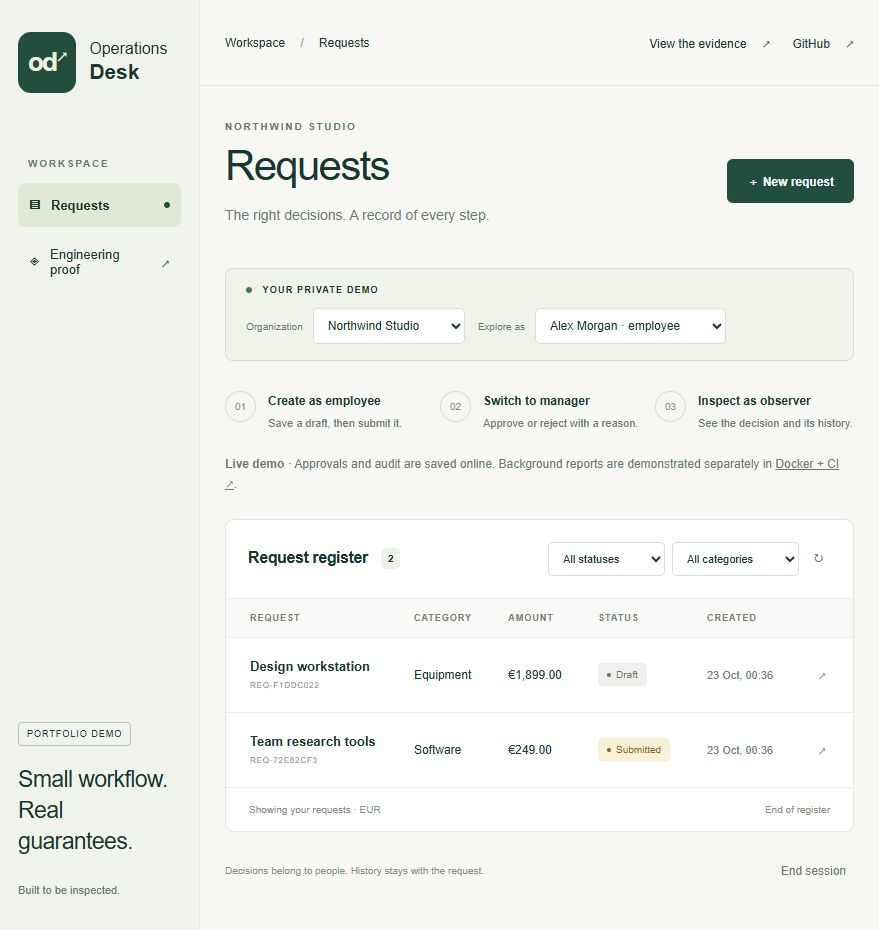
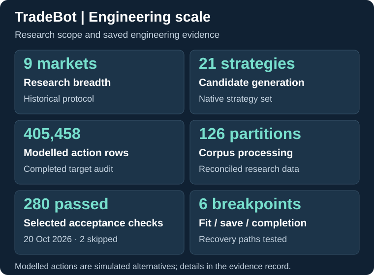

# Ivan Matiushkin

### Business applications, integrations and data systems

I build software that organizes operations, connects services and turns complex data into usable results. **From small fixes and focused automations to complete business applications.**

**Independent contractor · Poland · Remote**

**[Try the products](https://work.matiushkin.com/en) · [Discuss your project](mailto:ivan@matiushkin.com) · [Po polsku](https://work.matiushkin.com/)**

## Selected implementations

### Operations Desk — from a request to an accountable decision

A complete request-to-decision workflow: employees submit, managers review, and observers inspect the audit history. Organization boundaries keep records separate. Transactional commands handle repeated requests and competing decisions; the background processing environment recovers interrupted report jobs.

**Recorded verification:** 40 API/database assertions and five worker-recovery scenarios, plus desktop/mobile journeys. Try approvals online; inspect background recovery in Docker/CI.

[See the create → review → decision journey](docs/product-walkthroughs.md#operations-desk) · [Discuss an internal application](mailto:ivan@matiushkin.com?subject=Internal%20application)

[Try the application](https://operations-desk-reliability.vanya-matyushkin.workers.dev/) · [Inspect the evidence](https://operations-desk-reliability.vanya-matyushkin.workers.dev/proof/) · [Architecture and code](https://github.com/Hadezu/operations-desk-reliability)

### TradeBot — a connected research and simulation platform

Market data, strategy evaluation, experimental models, portfolio accounting and controlled research workflows form one interconnected platform.

**Implemented achievements:** continuous portfolio state, receipt-based reconciliation, version-bound learning targets, recovery at six model-completion interruption points, evidence-dependent admission and baseline-equivalence checks. [Explore the capability register](https://github.com/Hadezu/tradebot-ai-research-showcase/blob/main/docs/implemented-capabilities.md) · [Scale and provenance](https://github.com/Hadezu/tradebot-ai-research-showcase/blob/main/docs/engineering-scale.md).

[Explore the system](https://github.com/Hadezu/tradebot-ai-research-showcase) · [Engineering cases](https://github.com/Hadezu/tradebot-ai-research-showcase/blob/main/docs/engineering-case-studies.md) · [Verification scope](https://github.com/Hadezu/tradebot-ai-research-showcase/blob/main/docs/verification.md)

### Reconciliation Workbench — explain why two reports disagree

Compare CSV and Excel exports, isolate ambiguous matches and trace differences back to their source rows. The result is an HTML report and an Excel review workbook with inspectable evidence — a concrete starting point for a reporting or data-quality task.

[Explore the implementation](https://github.com/Hadezu/reconciliation-evidence-workbench) · [Download the example reports](https://github.com/Hadezu/reconciliation-evidence-workbench/releases/tag/v0.1.0) · [Discuss a reconciliation task](mailto:ivan@matiushkin.com?subject=Data%20reconciliation)

### Atomic CRM — a controlled import workflow inside an existing product

An extension to **Marmelab's Atomic CRM** gives operators a review step before contact creation: parsed CSV records, duplicate/conflict classification, explicit row selection and per-record outcomes. The implementation includes repeat-import checks and a browser-tested review journey.

[See the real import-review screen](docs/product-walkthroughs.md#atomic-crm) · [Case study](https://github.com/Hadezu/atomic-crm-import-review/blob/main/CASE-STUDY.md) · [Run the extension and inspect tests](https://github.com/Hadezu/atomic-crm-import-review)

### FastAPI webhook reliability — delivery that can be investigated and recovered

An extension to the **Full Stack FastAPI Template** connects signed catalog events to application records and an HTTP partner. PostgreSQL inbox/outbox transactions, durable receipts, leased workers and an operator console handle duplicates, lost responses and interrupted deliveries.

**Engineering evidence:** concurrent-event tests, process-crash scenarios, reasoned replay and a runnable Docker Compose environment.

[See the delivery and recovery flow](docs/product-walkthroughs.md#fastapi-delivery) · [Explore the implementation](https://github.com/Hadezu/fastapi-webhook-reliability) · [Recorded verification](https://github.com/Hadezu/fastapi-webhook-reliability/blob/main/docs/VERIFICATION.md)

### More systems and focused engineering work

[PostgreSQL import and guarded undo](https://github.com/Hadezu/postgres-import-rehearsal) · [Django approval workflows](https://github.com/Hadezu/operations-approval-desk) · [OAuth connection recovery](https://github.com/Hadezu/oauth-connection-recovery) · [AI extraction evaluation](https://github.com/Hadezu/llm-extraction-release-gate) · [Java retry repair](https://github.com/Hadezu/resilience4j-retry-review) · [Interactive portfolio source](https://github.com/Hadezu/work-portfolio)

**For technical evaluation and RFP/RFQ discussions:** the [capability and evidence index](docs/evidence-index.md) maps business requirements to implementations, test records and verification scope. Use it to assess the relevant architecture, implemented mechanisms and recorded checks for your project.

## Software I can build for your organization

**Complete products:** web applications, internal systems, operational dashboards and interactive interfaces.

**Connected workflows:** API integrations, process automation, document processing and data exchange.

**Product development:** CRM extensions, new modules, migration tools, reliability improvements and ongoing development.

**Small tasks are welcome:** a focused bug fix, an API connection, a report or an improvement to an existing workflow can be a standalone engagement.

From a new application to an existing system that needs to evolve, we agree the requirements, delivery stages and acceptance criteria around your business goal.

[Applications](https://work.matiushkin.com/en/services/internal-applications) · [Integrations](https://work.matiushkin.com/en/services/api-integration) · [Data workflows](https://work.matiushkin.com/en/services/data-migration) · [Software improvements](https://work.matiushkin.com/en/services/software-improvements)

## From requirements to a reviewable delivery

I define the intended result with you, organize implementation, review progress and make delivery decisions against agreed acceptance criteria. The project work above includes preserving account state across restarts, reproducing failures before changing code and testing complete user journeys.

**Requirements → delivery plan → implementation → acceptance checks → handover and evolution.**

The proposed delivery package includes agreed source code, setup documentation, verification results and operational notes. Changes to scope, hosting, ownership and ongoing support are agreed as part of the engagement. [Development process and concrete examples](docs/delivery-method.md).

## Discuss your project

I work with companies commissioning software and IT teams seeking an independent delivery partner — for complete applications, integrations, individual modules and long-term development.

Describe your workflow and the result you want. A short email is enough to begin; a finished technical specification or introductory call is optional. For initial examples, use synthetic or properly anonymized data.

[Send a project description](https://work.matiushkin.com/en/contact) · **[ivan@matiushkin.com](mailto:ivan@matiushkin.com)** · [Polish portfolio](https://work.matiushkin.com/) · [LinkedIn](https://www.linkedin.com/in/ivan-matiushkin-809694442/)
