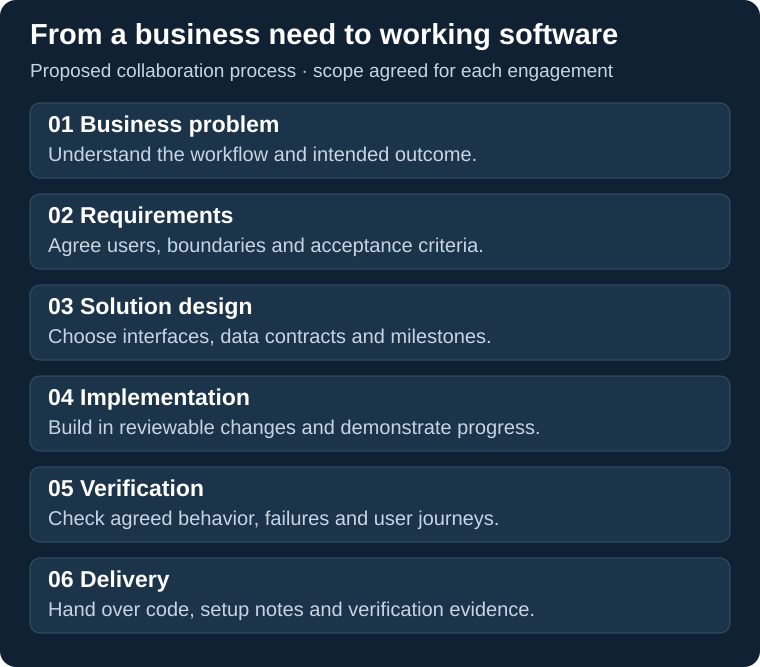

# Development process and delivery

[Back to profile](../README.md) · [Capability and evidence index](evidence-index.md)

## Turn the requirement into an observable result

A useful specification explains the desired behavior, the relevant failure cases and how acceptance will be demonstrated. I direct this process from the initial problem through implementation, review and the next development decision.

The portfolio contains concrete examples of that discipline:

| Requirement | Implementation decision | Evidence to inspect |
|---|---|---|
| Keep a competing approval from overwriting the accepted decision | Version checks and transactional command handling | [Operations Desk API, browser and release evidence](https://github.com/Hadezu/operations-desk-reliability/blob/main/docs/RELEASE.md) |
| Recover a completed model fit after interruption | Separate artifact verification, completion receipts and checkpoints | [TradeBot recovery case](https://github.com/Hadezu/tradebot-ai-research-showcase/blob/main/docs/engineering-case-studies.md) |
| Repair a scheduled-retry failure in an established library | Reproduce against the unchanged baseline, apply a bounded fix and test both versions | [Resilience4j case and baseline comparison](https://github.com/Hadezu/resilience4j-retry-review) |
| Let an operator review contacts before importing | Extend the existing CRM workflow with preview, classification and explicit selection | [Atomic CRM browser acceptance](https://github.com/Hadezu/atomic-crm-import-review/blob/main/docs/import-review-verification.md) |

These examples come from independent project development. They show the working approach and its technical evidence.

## Proposed collaboration

1. **Define:** clarify workflows, users, inputs, dependencies and the intended result.
2. **Plan:** agree the architecture direction, scope, milestones, cost and acceptance criteria. Discovery or prototyping can be a separate stage.
3. **Implement and review:** develop in bounded changes, inspect test results and demonstrate progress. Evaluate changes in requirements before expanding the work.
4. **Accept and hand over:** provide agreed source, dependency notices, setup/migration instructions, revision-linked checks and operational documentation.
5. **Evolve:** agree further features, maintenance responsibilities and support terms.

The contract defines the actual deliverables, ownership, deployment arrangements and service commitments.

## Implementation method

I use ChatGPT to develop requirements and examine options, and coding agents such as Codex and Antigravity for the main programming implementation and technical checks. I review their reports, assess results against the task and decide whether to accept, revise or investigate further.

My responsibility is product direction, task coordination and acceptance decisions. Architecture analysis, code implementation and automated checks are AI-assisted. Tool use, access to customer code and confidential-data handling are agreed before development begins.

## Starting and contracting

A written description is enough for an initial discussion. Sample data can be synthetic or properly anonymized. Detailed design, delivery stages and pricing follow the agreed scope.

Useme may handle contracts and payments where compatible with the engagement. It is a contracting intermediary; suitability for a particular procurement procedure is checked separately.

[Describe the project](https://work.matiushkin.com/en/contact) · [ivan@matiushkin.com](mailto:ivan@matiushkin.com)
