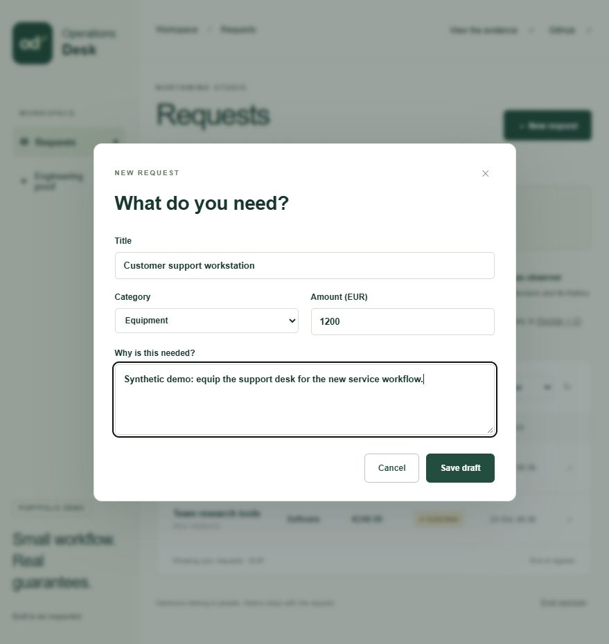
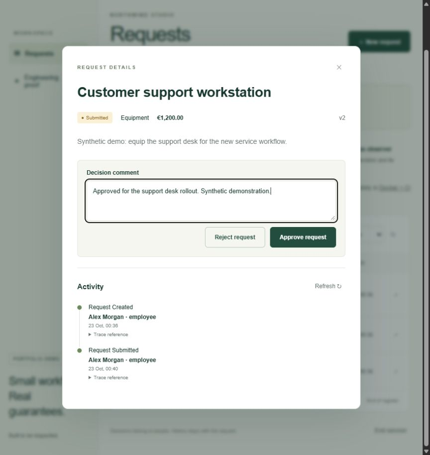
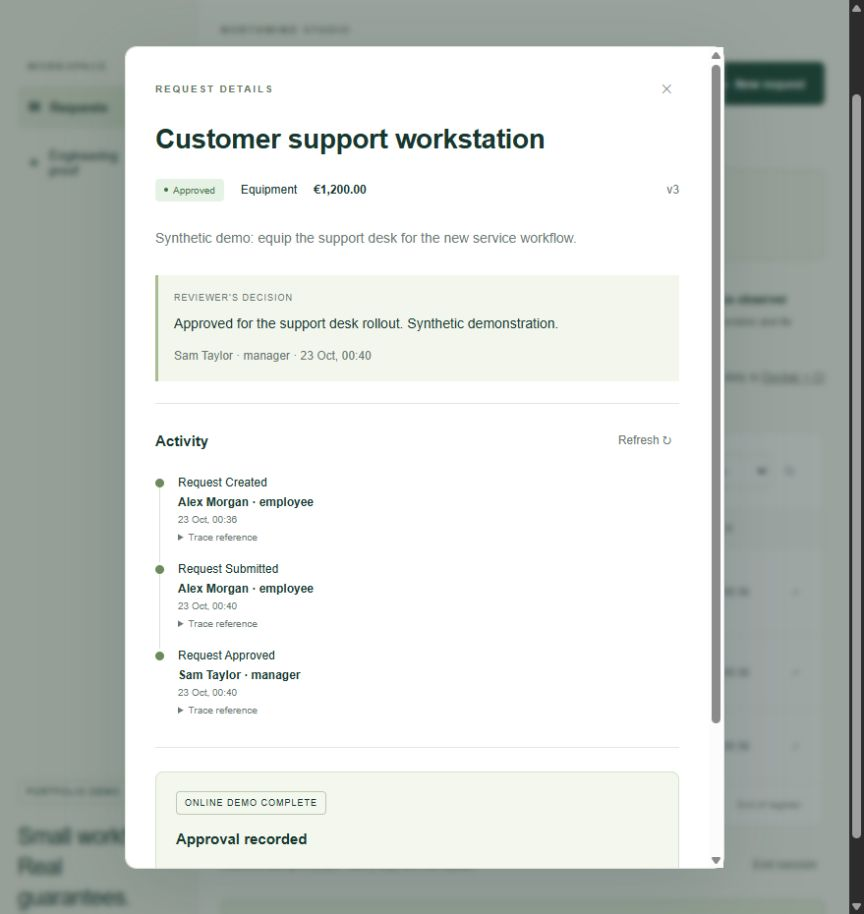
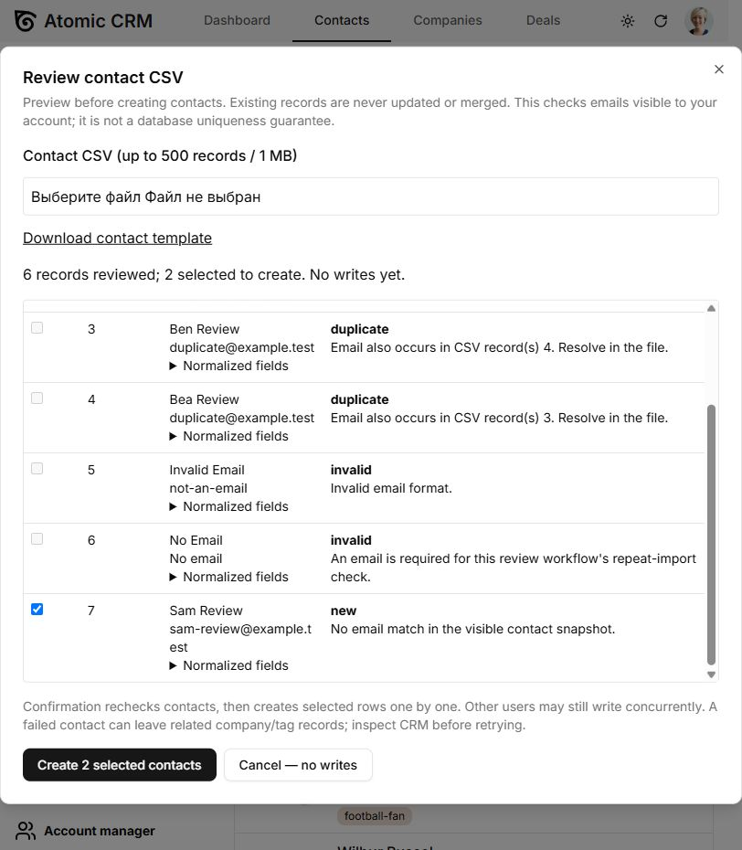
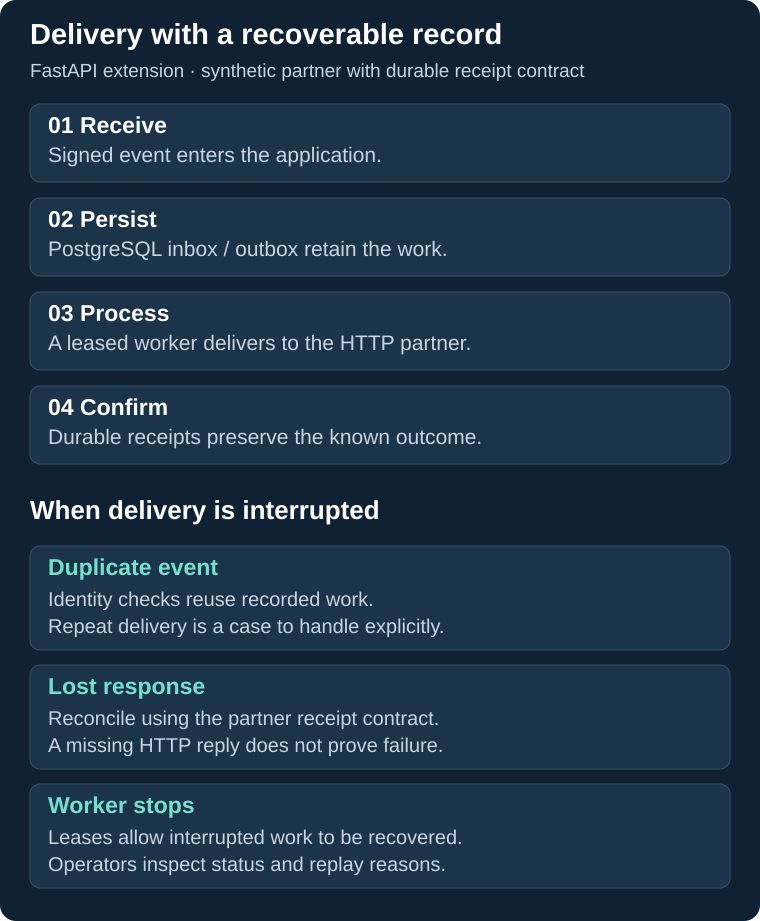

# Working software, visible workflows

[Back to portfolio](../README.md) · [Discuss your workflow](mailto:ivan@matiushkin.com)

## Operations Desk

**For a company that needs requests, accountable decisions and a searchable record.** The running demonstration follows the same request from employee to manager. All shown data is synthetic.

### Create the request

### Review with a reason

### Keep the decision and its history together

[Try the workflow](https://operations-desk-reliability.vanya-matyushkin.workers.dev/) · [Release verification](https://github.com/Hadezu/operations-desk-reliability/blob/main/docs/RELEASE.md)

## Atomic CRM

**For a team that wants to inspect imported contacts before creating them.** The extension adds CSV preview, duplicate classification and explicit row selection to Marmelab's Atomic CRM.

CSV → preview → duplicate review → selected records → per-record result.

The image shows the preview stage. The complete creation and repeat-import journey is documented in the [browser verification](https://github.com/Hadezu/atomic-crm-import-review/blob/main/docs/import-review-verification.md). This is the extension's recorded FakeRest demonstration.

## FastAPI delivery

**For a company connecting systems where an interrupted request must remain investigable.** The extension uses a persistent delivery record and a receipt-aware synthetic partner.

[Implementation and setup](https://github.com/Hadezu/fastapi-webhook-reliability) · [Verification](https://github.com/Hadezu/fastapi-webhook-reliability/blob/main/docs/VERIFICATION.md)

## Apply a similar pattern to your business

Approval portals, controlled imports and recoverable integrations can be combined or developed as standalone products. Describe the people, systems and outcome involved; scope and acceptance follow from that workflow.

[Discuss a project](mailto:ivan@matiushkin.com) · [Image provenance](visual-evidence.md)
